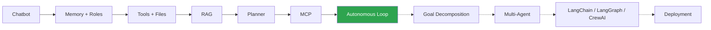
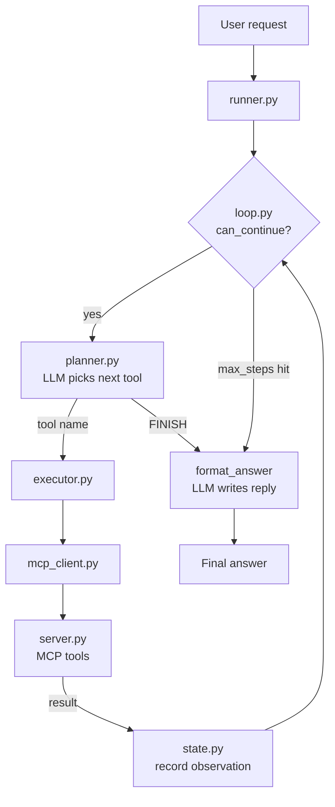

# From Chatbot to Agent 🤖

Building production-ready AI agents **from scratch in Python**, one layer at a time. It starts with a simple chatbot and works up to autonomous, tool-using, multi-agent systems.

Everything runs **locally** with [Ollama](https://ollama.com) (`qwen3`, `nomic-embed-text`). No paid API keys are needed.

> 🚧 **Work in progress.** New stages are added as they're built.

---

## 🧭 The journey



Solid arrows are built ✅. Dotted arrows are coming next 🔜.

---

## ✅ What's built so far

| Stage | Folder | What it does | Key concepts |
|---|---|---|---|
| 1 | `Day01` | Talks to a local LLM | OpenAI-compatible client, `.env` config |
| 2 | `Day02` | Remembers the conversation | Message history, context window |
| 3 | `Day03` | Plays different roles | System prompts, personas |
| 4 | `Day04` | Uses Python tools | Tool functions, command routing |
| 5 | `Day05` | Answers questions about documents | Grounded prompts, "not found" fallback |
| 6 | `Day06` | Searches by meaning (RAG) | Embeddings, cosine similarity, retriever |
| 7 | `Day07` | Decides which tool to use | LLM planner, assistant vs agent |
| 8 | `Day08` | Discovers tools over a protocol | MCP server + client, FastMCP, async |
| 9 | `Day09/agent` | **Works autonomously until done** | Agent state, think → act → observe loop, `max_steps` guard |

---

## 🏗️ Current architecture (Stage 9)



**Example run**
```
User : generate a secure password and tell me the current time

Planner Selected: generate_password
Planner Selected: current_time
Planner Selected: FINISH

Final Answer:
Here is your secure password: ... The current time is ...
```

The agent decides at runtime how many steps a request needs. A `max_steps` limit stops it from looping forever.

---

## 🔜 Where it's heading

| Next | Goal |
|---|---|
| **Goal decomposition** | Break a large goal into smaller tasks before acting |
| **Long-term memory** | Persist knowledge across sessions |
| **Vector databases** | Scale RAG beyond in-memory search (chunking, top-k, re-ranking) |
| **Multi-agent systems** | Specialised agents that collaborate |
| **Frameworks** | Rebuild with LangChain, LangGraph and CrewAI, and compare with the from-scratch versions |
| **Production** | Error handling, observability, Docker and deployment |

---

## ⚙️ Run it locally

**1. Install Ollama and pull the models**
```bash
ollama pull qwen3:1.7b
ollama pull nomic-embed-text
```

**2. Set up Python**
```bash
git clone https://github.com/shadankhan108/from-chatbot-to-agent.git
cd from-chatbot-to-agent
python -m venv .venv
source .venv/bin/activate        # Windows: .venv\Scripts\activate
pip install -r requirements.txt
```

**3. Create a `.env` file** in the stage folder you want to run
```
BASE_URL=http://localhost:11434/v1
API_KEY=ollama
MODEL=qwen3:1.7b
```

**4. Run the autonomous agent**
```bash
cd Day09/agent
python runner.py
```

---

## 🛠️ Tech stack

`Python 3.13` · `Ollama` · `qwen3` · `nomic-embed-text` · `OpenAI Python SDK` · `NumPy` · `FastMCP` · `asyncio` · `python-dotenv`

---

## 👤 Author

**Shadan Khan**, Master of Data Science (Deakin University), Melbourne.
Building AI agents from first principles to understand how they work underneath the frameworks.
